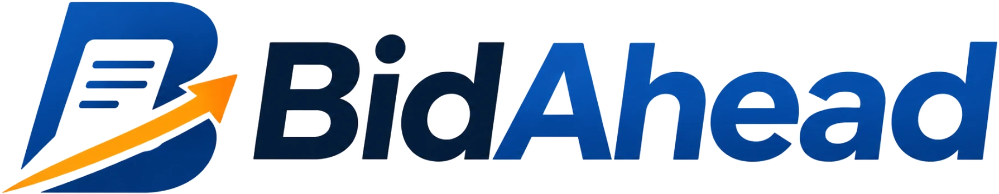
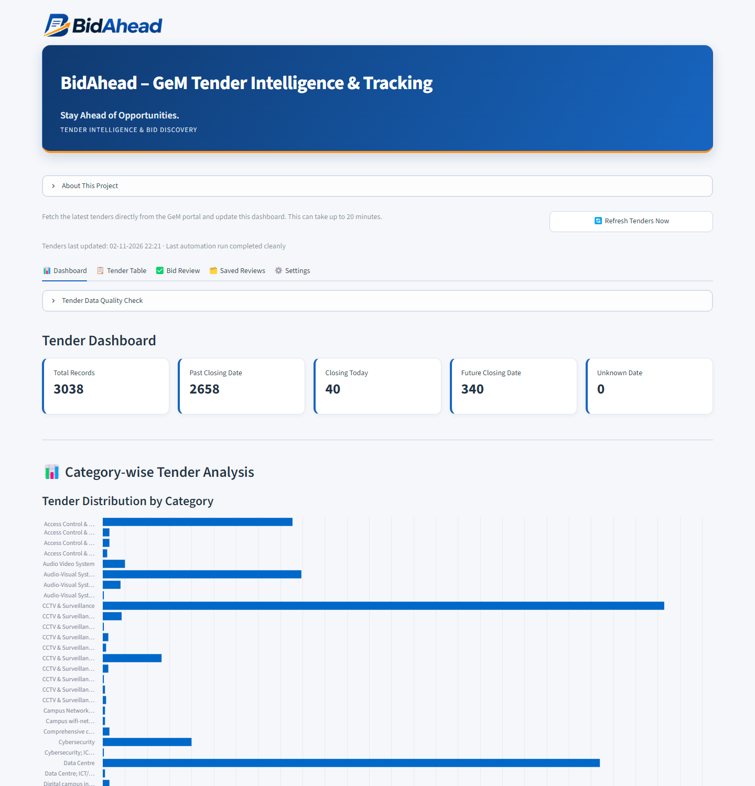
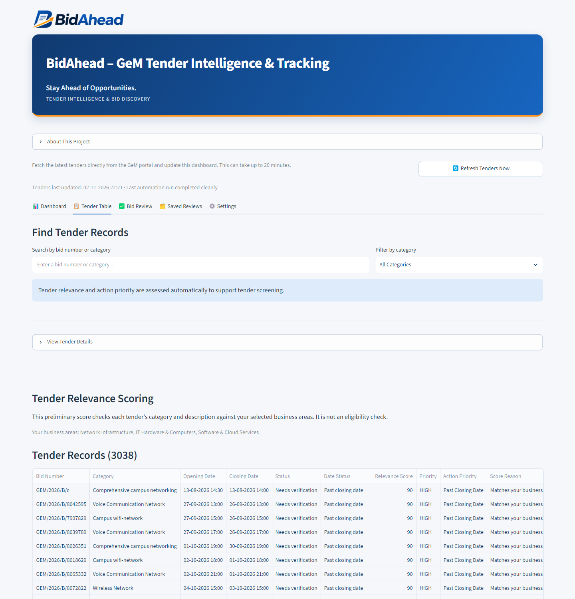

  

<h3 align="center">Stay Ahead of Opportunities.</h3>

<b>TENDER INTELLIGENCE &amp; BID DISCOVERY</b>

> **Showcase page.** This page shows what the product does. The product and its source code are proprietary and are not published. See [LICENSE](LICENSE).

## What it does

BidAhead helps businesses find and prioritise the government tenders that are worth bidding on, so their time goes to real opportunities instead of endless searching.

You tell it which sectors you work in. It keeps watch on India's GeM portal, ranks what it finds by how well it fits your business, tracks closing dates and keeps a record of every bid decision.

## Why it helps

- **Less searching.** Relevant tenders come to you, ranked, instead of you hunting through thousands of listings.
- **Fewer missed deadlines.** Closing dates are tracked and surfaced early.
- **Better decisions.** Every bid review is saved, so decisions are consistent and easy to look back on.
- **Works for any sector.** Choose from a wide range of industries, or define your own.

## Screenshots

| Dashboard | Tenders ranked for your business |
|---|---|
|  |  |

## Status

Working prototype. Planned next: more tender portals, team accounts and alerts.

## Skills shown

Product design · data pipelines · automation · analytics dashboards · testing

## Note

Scores are guidance, not an eligibility check. Always confirm tender details on the official portal before bidding.

## Contact

Interested in a demo or a licence? Message me on [LinkedIn](https://www.linkedin.com/in/abishek-f-151708222).
